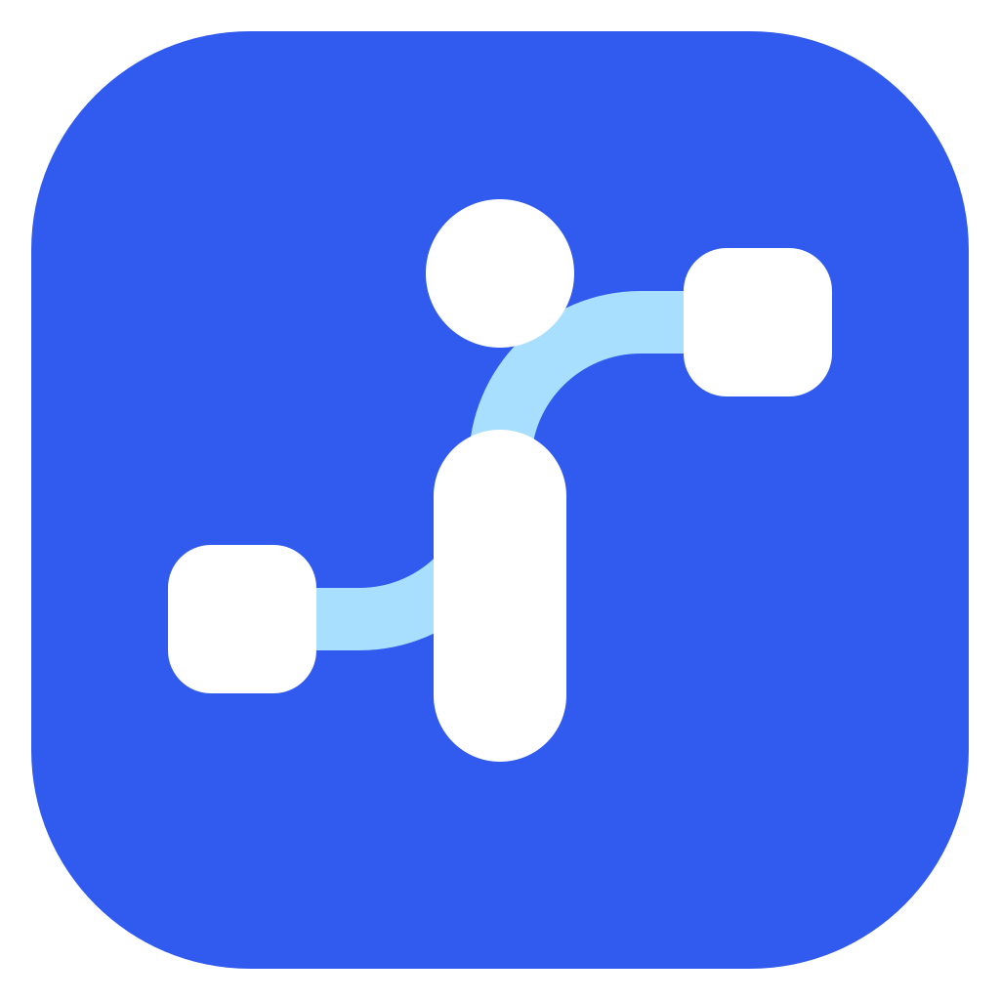

# iconic

[English](README.md) | [繁體中文](README.zh-Hant.md) | [日本語](README.ja.md)



AV 信号系統図、機器ラック、3D ルームレイアウトを作成するエディターです。**TanStack Start、React 19、Node.js** を使用し、**Electron** で macOS・Windows 向けのデスクトップアプリを提供します。

**英語・繁体字中国語・日本語**に対応しています。**iconic → 言語**で選択すると、設定がローカルに保存されます。ツールバーのボタンにマウスを合わせるか、キーボードでフォーカスすると、説明とショートカットが表示されます。

## ダウンロードとインストール

[GitHub Releases](https://github.com/mantou-fw/iconic/releases/latest) からダウンロードしてください。

| ファイル | 用途 |
| --- | --- |
| `iconic-0.3.0-arm64.dmg` | macOS Apple Silicon：DMG を開き、iconic をアプリケーションフォルダーにドラッグ |
| `iconic-0.3.0-x64.dmg` | macOS Intel：DMG を開き、iconic をアプリケーションフォルダーにドラッグ |
| `iconic-0.3.0-x64-Setup.exe` | Windows x64：インストーラーを実行 |
| `iconic-web-0.3.0.zip` | ポータブル Web サーバー。Node.js 22.20 以降が必要 |
| `iconic-agent-pack-0.3.0.zip` | AI クライアント用の MCP サーバー、スキル、インストーラー |
| `SHA256SUMS.txt` | ダウンロードファイルの SHA-256 チェックサム |

デスクトップ版には Node ランタイムが同梱されています。**Node.js の別途インストールが必要なのは、Web サーバーまたは MCP エージェントパックを使用する場合です。** 現在のインストーラーは未署名、またはアドホック署名で、macOS の公証は行っていません。macOS によって起動がブロックされた場合は、「システム設定 → プライバシーとセキュリティ → このまま開く」で確認できます。

ポータブル Web 版は ZIP を展開し、そのフォルダーで実行します。

```sh
NITRO_HOST=127.0.0.1 NITRO_PORT=4321 npm start
```

PowerShell：

```powershell
$env:NITRO_HOST="127.0.0.1"
$env:NITRO_PORT="4321"
npm start
```

[localhost:4321](http://localhost:4321) を開いてください。制御サーバーの待ち受けはローカルのループバックアドレスに限定してください。

## MCP とスキルの導入

1. iconic を起動し、図面を開いたままにします。
2. **iconic → AI ガイド**を選択します。
3. Codex、Claude Code、またはその他の MCP クライアントを選び、**エージェントパック**をダウンロードします。Releases からも入手できます。
4. ZIP を永続的に使用するフォルダーに展開します。**Node.js 22.20 以降**と npm をインストールしてください。MCP の依存関係は同梱済みなので、パック内で `npm install` を実行する必要はありません。
5. 展開した `iconic-agent-pack` フォルダーでターミナルを開き、対象のコマンドを実行します。

```sh
# 先に設定変更をプレビュー
node scripts/setup-agent.mjs --agent codex --with-skill --dry-run

# Codex：MCP の登録とスキルの導入
node scripts/setup-agent.mjs --agent codex --with-skill

# Claude Code：MCP の登録とスキルの導入
node scripts/setup-agent.mjs --agent claude-code --with-skill

# その他のクライアント：設定を変更せずに構成を出力
node scripts/setup-agent.mjs --agent generic
```

インストーラーは、選択したクライアントの**ユーザーレベル設定**に MCP を登録します。`--with-skill` は Vercel skills CLI 1.7.4 を使用するため、インターネット接続が必要です。完了後に AI クライアントを再読み込みしてください。MCP はパックの絶対パスを使用するので、展開先を移動しないでください。別のポートを使用する場合は、`--url http://localhost:8080` を追加します。異なる場所を参照する既存の登録は、明示的に `--replace` を指定しない限り保持されます。

最後の接続確認は読み取り専用です。終了コード **2** は、設定は保存されましたが、アプリへの接続が未確認であることを示します。アプリを開いたまま再試行してください。

```sh
node scripts/mcp-check.mjs
# macOS／Linux で別のポートを使用する場合：
AV_CANVAS_URL=http://localhost:8080 node scripts/mcp-check.mjs
```

このリポジトリからスキルのみを直接導入する場合：

```sh
npx skills@1.7.4 add https://github.com/mantou-fw/iconic --skill av-schematic -a codex -a claude-code -g --copy
```

**スキルの導入だけでは MCP は登録されません。** パックまたはソースのチェックアウトからローカルスキルを導入する場合は、GitHub URL を `.` に置き換えます。その他のクライアントでは、対応する skills agent ID を指定してください。

ソースのチェックアウトから MCP を手動登録する場合（先に `npm ci` を実行）：

```sh
codex mcp add av-schematic -- node /absolute/path/to/iconic/mcp/server.mjs
```

汎用 MCP 設定（実際の絶対パスに置き換えてください）：

```json
{
  "mcpServers": {
    "av-schematic": {
      "command": "node",
      "args": ["/absolute/path/to/iconic-agent-pack/mcp/server.mjs"],
      "env": { "AV_CANVAS_URL": "http://localhost:4321" }
    }
  }
}
```

Codex への依頼例：**「$av-schematic を使い、現在のキャンバスを読み取ってから、既存の内容を残して会議室の AV システムを追加してください。」**

MCP サーバーには、機器、ゾーン、ケーブル、ラック、レイアウト、3D ルーム用の 17 個のツールがあります。編集前にキャンバスを読み取り、削除・消去は明示的な指示がある場合のみ行います。JSON と PNG／SVG／PDF／HTML／XLSX の出力は、アプリで手動実行します。[MCP 設定](doc/mcp-integration.md)、[エージェントの配布](doc/agent-distribution.md)、[スキル](.agents/skills/av-schematic/SKILL.md)も参照してください。

正確な製品型番やデータシートを AI に渡すと、`import_product` で確認済みポートと出典を含む機器ノードを作成できます。画像を認識できる AI に部屋の写真や平面図を渡すと、`import_room_layout` で 3D レイアウトを作成できます。既知の寸法を指定するか、推定と仮定を明記して作成します。調査と画像の解釈は AI クライアントが行います。既存内容は標準で保持され、JSON プロジェクトには部屋、出典、縮尺の仮定も保存されます。[インポート手順](.agents/skills/av-schematic/references/imports.md)を参照してください。

## プロジェクトとバージョン履歴

**iconic → プロジェクトとバージョン**でプロジェクトを作成・切り替えできます。各プロジェクトは独立した Couchbase Lite JavaScript データベースを持ち、編集内容はローカルに自動保存されます。バージョン名を入力すると完全なスナップショットを保存できます。復元時は現在の内容をバックアップし、新しいバージョンを作成します。図面、画像、接続、3D ルーム、設定、表示位置を含みます。

初回起動時に既存の IndexedDB 図面を「既存の図面」プロジェクトへコピーし、元のデータベースを保持します。JSON ファイルを開くと別のプロジェクトを作成します。JSON 出力形式の互換性は維持され、履歴はローカルデータベースに残ります。保存先はブラウザー／Electron のプロファイルとオリジンごとに分かれ、クラウド同期は設定されません。公式 JavaScript SDK は IndexedDB を使用し、Couchbase のライセンスで提供されます。ビルドには `licenses/couchbase-lite.txt` が含まれます。[保存方式の詳細](doc/project-storage.md)を参照してください。

## 開発

Node.js 22.20 以降と npm が必要です。開発、テスト、ビルドには Node.js と npm を使用します。

```sh
git clone https://github.com/mantou-fw/iconic.git
cd iconic
npm ci
npm run dev                 # http://localhost:4321
npm run desktop:dev         # Electron + TanStack Start
npm run typecheck
npm test
```

開発用ポートは `PORT` で変更できます。ブラウザー、デスクトップ開発版、パッケージ版は、それぞれ独立した IndexedDB ストレージを使用します。図面の移行にはプロジェクト JSON のインポート／エクスポートを利用してください。iconic デスクトップ版は初回起動時に旧アプリのプロファイルを一度だけコピーし、元のデータを保持します。データベース名（`av-schematic-db`）と JSON 形式（`av-schematic`）には互換性があります。

## ビルドとリリース

```sh
npm run build                    # TanStack Start + Nitro Node サーバー
npm start                        # .output/server/index.mjs を起動
npm run desktop:pack             # インストーラーにまとめる前の Electron アプリ
npm run desktop:build:mac        # Apple Silicon + Intel DMG。macOS が必要
npm run desktop:build:windows    # Windows x64 インストーラー
npm run agents:pack              # 単体の MCP／スキル ZIP
npm run release:web              # ポータブル Node サーバー ZIP。先に npm run build を実行
npm run icons:build              # SVG から PNG／ICO を生成。macOS では ICNS も生成
```

生成物は `release/` に出力されます。`npm run build` とデスクトップビルドは、アプリ内の `/downloads/iconic-agent-pack.zip` も更新します。

[リリースワークフロー](.github/workflows/release.yml)は、ネイティブの macOS・Windows runner 上でテストとビルドを実行します。`v*` タグを push すると、DMG、EXE、エージェントパック、Web 版 ZIP、SHA-256 チェックサムを公開します。`main` でワークフローを手動実行すると、リリースを作成せずに、ダウンロード可能な Actions artifacts を生成できます。ネイティブ Windows ビルドでは実行ファイルのアイコンとメタデータを設定します。macOS からのクロスビルドでもインストーラーを作成できますが、Windows ツールがない場合は PE リソースの編集を省略します。署名済みビルドを配布する場合は、署名と macOS 公証を別途設定してください。

新しいリリースでは、先にパッケージのバージョンを更新し、それと一致する新しいタグを作成します（以下の `X.Y.Z` を置き換えてください）。

```sh
git tag vX.Y.Z
git push origin main refs/tags/vX.Y.Z
```

## アーキテクチャ

```text
AI クライアント → Node MCP stdio（mcp/server.mjs）
                    ↓ fetch
           TanStack Start /api/canvas
                    ↕ コマンド ID／応答
           React Flow + Three.js（Electron またはブラウザー）
```

- `src/routes/`、`src/router.tsx`、`src/server.ts`：ルーティング、HTML ドキュメント、本番環境の CSP nonce。
- `src/server/canvas-broker.mjs`：アクティブな図面の接続リース、コマンドと応答の対応付け、タイムアウト、有効期限の処理。
- `src/server/canvas-handler.ts`：ループバック Host とブラウザー Origin の検証。
- `src/lib/ai-bridge.ts`：renderer 側の検証、ポーリング、React の更新完了後の応答。
- `src/lib/i18n.ts`、`src/locales/`：言語設定と翻訳カタログ。翻訳キーは 3 つの JSON すべてに追加します。ユーザーが作成した図面の内容は翻訳しません。
- `desktop/`：分離された Electron renderer とローカルサーバーのライフサイクル。Node integration は無効、context isolation と sandbox は有効のまま維持します。
- `.agents/skills/av-schematic/`：標準となるポータブルスキル。設定・ツールの参照は相対パスです。

AV 機器、ゾーン、ラック、図面表題欄、テキスト、メモ、図形、画像、ペン、ケーブル経路、凡例、3D 配置、プロジェクト／画像／PDF／HTML／XLSX 出力に対応しています。[キャンバスガイド](doc/canvas-guide.md)と[変更履歴](CHANGELOG.md)を参照してください。
